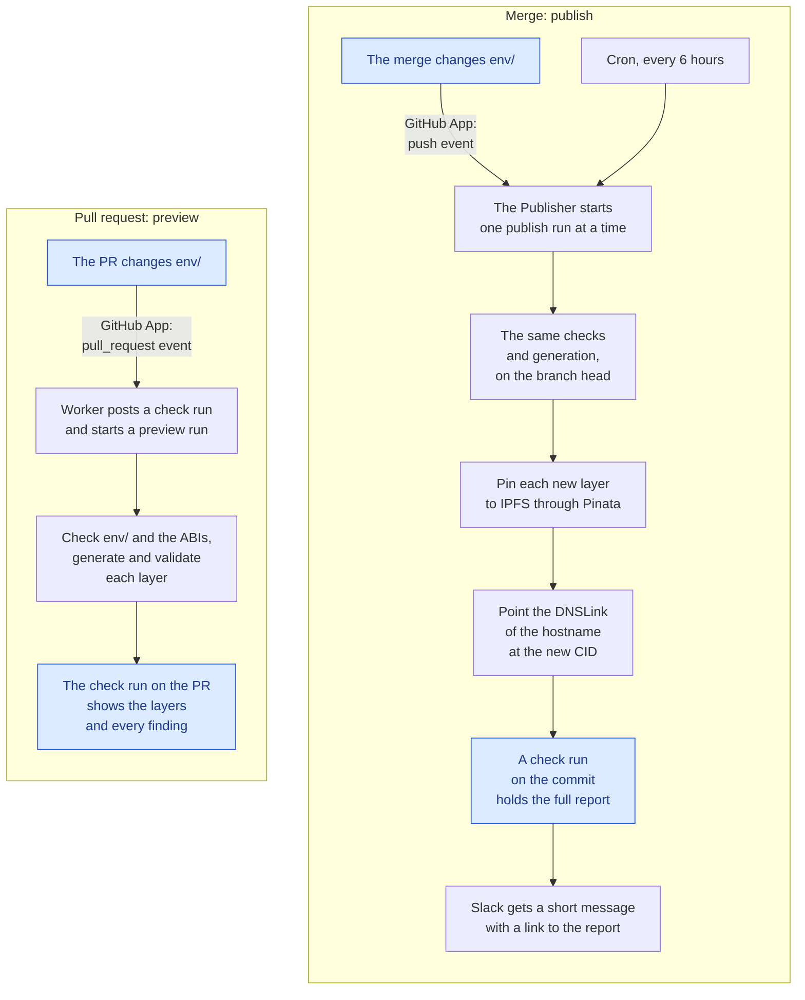

# How the registry works

The contract registry tells indexers and apps which Centrifuge protocol contracts exist on each chain.
For each deployed contract, it gives the address, the deploy block and the ABI. When a contract is no
longer in use, it also gives the block where its listener ends. There is one registry per network:

- **mainnet**, served at `https://registry.centrifuge.io`
- **testnet**, served at `https://registry.testnet.centrifuge.io`

Two repositories make the registry:

- **The protocol repository holds the inputs.** Its deploy scripts record each deployed contract in
  `env/` on the release branch. Its release tags give the source of each ABI.
- **This repository holds the program.** A Worker reads protocol's `env/`, generates the registry
  from it, and publishes the result.

A GitHub App connects the two repositories. It sends protocol's push, pull request and check run
events to the Worker. It also lets the Worker read protocol and post check runs there. An R2 bucket
carries the ABIs from protocol to the Worker.

The Worker replaces the [`script/registry/`][pi-script-registry] scripts and the
[`registry.yml`][pi-registry-yml] workflow that each live branch of protocol carried.
[registry-format.md](registry-format.md) describes the layer format. [operations.md](operations.md)
describes day-to-day operation.

## The flow

A pull request into the release branch gets a preview. A merge into the release branch publishes.

The blue boxes are in protocol. All other boxes are in the Worker.

- `SOURCE_BRANCH` in `wrangler.jsonc` names the release branch. Today it is [`live-v3.3`][pi-branch].
- Only a push or a pull request that changes `env/` starts a run. A pull request that changes nothing
  under `env/` gets no check run. A draft pull request gets a preview too.
- The cron is a trigger of the Worker itself. It asks for a publish run every six hours, so a missed
  event or a failed run gets a retry.
- A maintainer can also start a preview or a publish run with `POST /runs`. See
  [operations.md](operations.md#manual-runs).

**What a publish adds.** Each registry is a chain of JSON documents on IPFS. Each document is a
**layer**. A layer carries only what changed since the previous layer. It names that layer by CID in
`previousRegistry.ipfsHash`. The first layer is a base snapshot. To read a registry, walk the chain
from the newest layer back to the base, and merge the layers. The newest layer wins.

A publish run adds one layer to each network that has changes and no errors. The hostname of each
network is a Web3 gateway hostname. Its DNSLink names the CID of the newest layer. So the run pins
the new layer first, and then points the DNSLink at its CID.

## The pieces

### In protocol

- **[`env/`][pi-env] on the release branch.** This is the record of what is deployed.
  - `env/<environment>/<network>.json` is the config of one chain. Deploy scripts write it.
  - [`env/registry.json`][pi-registry-json] says which directory each registry publishes. People
    write it.
  - `env/<environment>/versions.json` and `env/<environment>/retired.json` are optional. People write
    them. `versions.json` maps a `version` to a tag. `retired.json` declares the contracts that are
    out of use.
- **[Release tags][pi-tags]** (`v3.3.0`, …). Each contract `version` resolves to a tag. The ABI of
  the contract comes from the source at that tag.
- **[`build-abis.yml`][pi-build-abis]**, on `main`. When someone pushes a release tag, this workflow
  builds the ABIs of the tag once. It uploads them to the R2 bucket under `abis/<tag>/`. The Worker
  cannot run git or forge, so it needs these builds.
- **The installation of the GitHub App** "Centrifuge Protocol Registry". The App is installed on
  protocol only.

The protocol repository does not generate, validate or publish the registry. This repository does.

### In this repository

- **The Worker** (`src/index.ts`, `src/webhook.ts`). It receives the events, decides what each event
  asks for, and starts runs. Its cron and `POST /runs` start runs too.
- **Publisher** (`src/publisher.ts`), a Durable Object. It lets one publish run go at a time. See
  [One publish at a time](#one-publish-at-a-time).
- **RegistryRun** (`src/workflow.ts`), a Workflow. It does one run as durable steps. Each step
  retries on its own.
- **The generator** (`src/core/`). It computes and validates the layers. It does no I/O. The clients
  for GitHub, IPFS, Pinata, the gateway API and Slack are in `src/io/`.
- **`@centrifuge/registry-core`**, on npmjs. It is the layer reading and verification code of
  `src/core/`, for consumers that pin a registry head (see the README's Package section).
- **`wrangler.jsonc`**, the settings of the Worker: `SOURCE_REPO`, `SOURCE_BRANCH`, `PUBLISH_MODE`,
  the hostnames and the zone.

### Outside both repositories

- **The R2 bucket `centrifuge-protocol-registry`**. The infrastructure repository manages it. It
  holds the ABI bundles from `build-abis.yml`, and the caches and run output of the Worker. See
  [What lives where](#what-lives-where).
- **Pinata** pins each published layer to IPFS.
- **The Web3 gateway hostnames** `registry.centrifuge.io` and `registry.testnet.centrifuge.io`. The
  DNSLink of each hostname names the CID of its newest layer.
- **Slack** receives a short message for each publish, refusal and failure. A publish or refusal
  message links to the full report on GitHub.
- **Consumers** are the indexers and apps that read the chain: api-v3, event-lake and the apps built
  on it. See [Consumers](#consumers).

### How they connect

| From → to                 | When                                                                                                                                          | Credential                                                                                                                                  | What crosses                                                                                                                                                                                   |
| ------------------------- | --------------------------------------------------------------------------------------------------------------------------------------------- | ------------------------------------------------------------------------------------------------------------------------------------------- | ---------------------------------------------------------------------------------------------------------------------------------------------------------------------------------------------- |
| protocol → Worker         | A push to the release branch. A pull request into it opens, gets new commits, reopens or becomes ready for review. Someone re-runs the check. | `GITHUB_WEBHOOK_SECRET`. The Worker checks the HMAC signature of each event.                                                                | The event: the branch, the changed paths, and for a pull request its number and head commit                                                                                                    |
| Worker → protocol, reads  | Each run, and each event that asks for a preview                                                                                              | An installation token of the App. The Worker signs a JWT with `GITHUB_APP_ID` and `GITHUB_APP_PRIVATE_KEY`, and exchanges it for the token. | The head of the release branch, `env/` at a commit, tags and their commits, the files of a pull request                                                                                        |
| Worker → protocol, writes | Each pull request preview. Each publish run that publishes or refuses.                                                                        | The same installation token                                                                                                                 | For a preview, the "Registry preview" check run on the head commit of the pull request. For a publish, the "Registry publish" check run on the commit it published from, with the full report. |
| protocol → R2             | `build-abis.yml` runs for a pushed release tag, or by hand                                                                                    | `R2_ACCESS_KEY_ID` and `R2_SECRET_ACCESS_KEY`, repository secrets of protocol. They give access to this bucket only.                        | `abis/<tag>/<Artifact>.json` and `abis/<tag>/manifest.json`                                                                                                                                    |
| R2 → Worker               | Each run                                                                                                                                      | The `REGISTRY_BUCKET` binding                                                                                                               | The ABI bundles                                                                                                                                                                                |
| IPFS gateways → Worker    | Each generate step                                                                                                                            | None                                                                                                                                        | The published layers, to walk the chain. R2 caches each layer by CID.                                                                                                                          |
| Worker → Pinata           | Each publish run in `pin` or `live` mode                                                                                                      | `PINATA_JWT`                                                                                                                                | The new layer                                                                                                                                                                                  |
| Worker → gateway API      | Each run in `live` mode. Below `live`, the Worker reads the CID from public DNS.                                                              | `CLOUDFLARE_API_TOKEN`                                                                                                                      | The CID that the hostname serves. For a publish, also the new DNSLink `/ipfs/<cid>`.                                                                                                           |
| Worker → Slack            | A publish run that publishes, refuses or fails. A cron run does not repeat its last message.                                                  | `SLACK_WEBHOOK_URL`                                                                                                                         | One short message. A publish or refusal message links to the "Registry publish" check run.                                                                                                     |

The App sends its events to `POST /webhooks/github` on the Worker. The App has Contents read, Pull
requests read and Checks write. So the Worker can read protocol and post check runs, but it cannot
change the code or the files of protocol. The App has no Actions permission, so the Worker cannot
start or read the workflows of protocol.

## A change, from deploy to published layer

1. **A deploy writes configs.** A deploy script records what it deployed in protocol's
   [`env/<environment>/<network>.json`][pi-env], on a branch. Someone then opens a pull request into the release
   branch. `SOURCE_BRANCH` in `wrangler.jsonc` names the release branch (`live-v3.3` today).
2. **The pull request gets a preview.**
   - GitHub sends the `pull_request` event of the App to `POST /webhooks/github`.
   - The Worker checks the HMAC signature of the event and lists the files of the PR.
   - If a file is under `env/` (other than the connections viewer), the Worker posts a **Registry
     preview** check run. It then starts a preview run on the head commit of the PR.

   A PR that touches nothing under `env/` gets no check. For this reason, the check cannot be a
   required check. "Re-run" on the check starts the preview again.

3. **The run.** Its steps are:
   1. **Resolve the commit:** the PR head for a preview, the head of the release branch for a publish
      run.
   2. **Check `env/`** at that commit: the schema of the configs, `retired.json`, `versions.json`, and
      that every contract `version` resolves to a tag. A problem here ends the run.
   3. **Ensure ABIs:** every tag that `env/` uses must have a bundle in R2, built from the commit that
      the tag points at. If a bundle is missing, the step retries every 2 minutes for up to an hour.
      That time covers a `build-abis.yml` run in progress. After that, the step fails and names the
      tag.
   4. **Generate each network:** walk the published chain of the network from the live CID back to the
      base snapshot. Compute the layer against the accumulated state, and validate the layer (see
      [registry-format.md](registry-format.md)).
   5. **Report:** a preview completes the check run with the layer that each network would get, and
      with every finding. The check run fails when a layer would break the indexer. A publish run
      continues with the steps in item 4.
4. **The merge publishes.** The merge is a push to the release branch. A push that touches `env/` asks
   the Publisher for a publish run. The run generates from the head of the release branch. Then, for
   each network whose layer is publishable (it changes something) and has no errors, the run:
   1. **pins** the layer to IPFS through Pinata.
   2. **points** the hostname of the network at the new CID, through the gateway API. Before that,
      the run checks that the hostname still serves the CID that the layer was built on. If something
      else published a layer in between, the run stops, because the new CID would orphan that layer.

   The run judges each network on its own, so an error on testnet does not stop mainnet.

   The run then reports in two places:
   - A **Registry publish** check run on the commit it published from holds the full report. Anyone
     who can read protocol can open it.
   - Slack gets one message per publish run. The message has one line for each network that the run
     published, pinned or refused, and a link to the check run.

   A manual run reports on a **Registry publish (manual)** check run instead. Its refusal is neutral,
   so a run that someone tries by hand does not mark the release branch red.

5. **The cron reconciles.** Every six hours, the Worker asks for a publish run. So the Worker retries a
   webhook that GitHub dropped, or a run that failed, before anyone notices. A run with nothing to
   publish posts nothing. A cron run that would repeat the last message posts nothing too.

A manual `POST /runs` (with the bearer token) can preview any commit. It can also start a publish run
with options, such as a mode or a source CID. See [operations.md](operations.md).

## One publish at a time

Two publish runs computed against the same tip would both pin a layer that points at that tip. The
second DNSLink swap would then orphan the first layer. So every publish trigger (push, cron, manual)
goes to the Publisher, a single Durable Object. The Publisher starts a run when no run is active.
Otherwise, it keeps the trigger as the one pending run, and starts it when the active run ends.

A run generates from the head of the release branch, so a newer trigger replaces the pending run. There
is one exception: a push or the cron does not replace a pending manual run, because a manual run may
carry options. An alarm checks whether the active run ended. So a run that stops without a report
cannot block publishing. Previews do not use the Publisher, because they publish nothing.

## How far a publish goes: `PUBLISH_MODE`

| Mode     | Generates | Pins to IPFS | Points the hostname | Credentials it needs                 |
| -------- | :-------: | :----------: | :-----------------: | ------------------------------------ |
| `shadow` |     ✓     |              |                     | none beyond the App and Slack        |
| `pin`    |     ✓     |      ✓       |                     | `PINATA_JWT`                         |
| `live`   |     ✓     |      ✓       |          ✓          | `PINATA_JWT`, `CLOUDFLARE_API_TOKEN` |

`PUBLISH_MODE` is a variable in `wrangler.jsonc`. To change it, merge a change to `main`.
The merge deploys the Worker. The Worker holds only the credentials that its mode needs, because
`scripts/push-secrets.sh` uploads them by mode. A mode without its credentials refuses to run. It
does not do less instead. Until `live`, the Worker cannot change what the hostnames serve.

In `pin` mode, the Worker pins a publishable layer and posts its CID to Slack, but nothing points at the
layer. So `pin` is the place to inspect a real layer before a hostname serves it.

`CLOUDFLARE_API_TOKEN` is the Web3 hostnames token that the infrastructure repository manages. It
has Web3 Hostnames Write and DNS Read on `centrifuge.io`. It can point any Web3 hostname on the zone at
a new CID, not only the registry hostnames. For this reason, the Worker holds it only in `live` mode.

## What keeps a publish safe

- **Previews before merges.** Every PR into the release branch that touches protocol's [`env/`][pi-env]
  shows the exact layers it would publish, with every finding, before it merges.
- **Deltas against the whole chain.** The Worker computes a layer against the accumulated state of
  every published layer, never against the newest layer alone. So a layer carries exactly what changed.
- **Verified layers.** The Worker checks the bytes of every layer that it reads against the CID of the
  layer, from an IPFS gateway or from the R2 cache. It skips a gateway that serves other bytes. It
  fetches a cache entry that does not match again, and overwrites it. If no gateway serves the correct
  bytes, the walk stops. When a gateway served other bytes, no override applies.
- **Refusals instead of guesses.** A run stops, and publishes nothing, when it:
  - cannot read the live layer.
  - cannot walk the whole chain.
  - finds a layer of the other network.
  - would produce a layer with validation errors.
- **Nothing is retired by omission.** A contract missing from `env/` stays as published. Retirement is
  a declaration in protocol's [`retired.json`][pi-env] (see
  [registry-format.md](registry-format.md#retirement)).
- **One publisher, and a moved tip stops it.** The Publisher lets one publish run go at a time. Before a
  publish run points a hostname at a new CID, it checks that the hostname still serves the CID it built
  on.
- **Staged credentials.** Each of `shadow`, `pin` and `live` gives the Worker one more capability.

## Consumers

Consumers read the registry in one of two ways.

- **Following the hostname.** Fetch `https://registry.centrifuge.io`. Then walk
  `previousRegistry.ipfsHash` back to the base snapshot, and merge the layers: older first, newer
  overriding. You get what the hostname serves, so a new publish reaches you on your next read.
- **Pinning a head.** Keep the CID of the newest layer you accepted. Walk from it, and move it forward on
  purpose. event-lake works this way:
  - It keeps one head per network in `registry.manifest.json`.
  - It checks every layer it reads against its CID.
  - From the result, it builds the address book that the indexer, handlers, private API and SDK use.

  This repository publishes the code that event-lake uses to read and verify layers, as
  `@centrifuge/registry-core` (see the README's Package section). `verifyLayer` proves that the bytes
  are the ones a CID names. `isAncestor` and `diffAddressHistories` check that a pin bump only moves
  forward, and show what the bump changes.

api-v3 reads a `REGISTRY_URL`, which can be the hostname or a fixed layer. Its reader folds a
null-version patch layer into its predecessor. It also collapses consecutive layers that have the same
version.

Both ways, a consumer ends the listener of a contract at the `endBlock` of its `retired` entry. A
consumer never infers an end from the next release. Pools migrate one by one, so a contract absent
from a newer layer stays in use until a retirement closes it.

## Assumptions

This section lists what the system takes for granted, and what breaks when an assumption stops being
true.

### Inputs

- **protocol's [`env/`][pi-env] on the release branch is the record of what is deployed.** Deploy
  scripts write it, and nothing else feeds the registry. The Worker does not publish a contract that is
  deployed but not recorded. It publishes a config edited by hand as written.
- **One release branch publishes.** `SOURCE_BRANCH` names it. Other live branches publish nothing. A
  new release reaches the registry only after a change that sets `SOURCE_BRANCH` to its branch merges
  to `main`. The merge deploys the Worker.
- **Every config entry has an integer `blockNumber`.** The Worker derives the start block of the chain
  from these numbers. Generation refuses an entry without one. It does not fetch the number from
  elsewhere.
- **Every contract `version` resolves to a tag**, directly or through protocol's
  [`env/<dir>/versions.json`][pi-env]. An alias is the claim of the deployment that it runs the source at that
  tag. Nothing checks this claim, so reviewers treat an alias like code.
- **Absence is not retirement.** Retirement is a declaration in protocol's [`retired.json`][pi-env]. A
  contract that `env/` stops listing stays published. A release that replaces a contract under a new key
  must retire the old contract. Otherwise, indexers keep listening to both.

### ABIs

- **The source at a tag never changes.** protocol's [`build-abis.yml`][pi-build-abis] builds each tag once, and
  the bundle records the commit. The Worker refuses a moved tag until someone builds it again.
- **Every tag is built.** `build-abis.yml` runs when someone pushes a tag. GitHub starts no run for a
  tag pushed with `GITHUB_TOKEN`, or for more than three tags in one push. Someone dispatches the
  workflow by hand for those tags, and for tags from before the workflow. Until a tag that the configs
  use has a bundle, every run waits for it, then fails and names the tag.
- **An artifact name is unique enough.** Bundles use the artifact name as their key. The first artifact
  wins, from `out/` then `out-ir/`. A collision with a different ABI is a warning in the build, not an
  error.
- **A contract key names its artifact.** The key is capitalized (`hub` → `Hub`). A factory also needs
  its product. A key that does not map needs an entry in `src/core/abi-names.ts` **in this
  repository**. Until that entry lands here, a change in protocol that adds such a key fails its
  preview with a missing ABI.

### Publishing

- **The Worker is the only publisher.** Nothing else changes the DNSLinks of the hostnames. The Worker
  detects a change made by hand, because the hostname no longer serves the CID that a layer was built
  on. The publish run then stops. That stop is the safety, so after a manual change, start a run that
  builds on it.
- **Generation is deterministic.** The same `env/`, live layer and ABIs give the same bytes, and so the
  same CID. So you can check a layer before the Worker publishes it, and a retry pins the same layer.
- **Pinata's layout stays as it is.** The Worker uploads layers through the public files API of Pinata.
  That API gives CIDv1, raw leaves, 256 KiB chunks and a balanced DAG of 174 links. `verifyLayer` in
  `@centrifuge/registry-core` rebuilds CIDs the same way. If Pinata changed its layout, new layers
  would fail verification. Consumers would refuse them, and so would the next walk of the Worker, which
  then publishes nothing.
- **Every published layer stays pinned.** Consumers walk the chain back to the base snapshot, so every
  layer must stay retrievable. The Worker caches layers in R2. Consumers do not.
- **Mainnet is never reset.** Its chain only grows. A testnet reset is a full snapshot that a run asks
  for explicitly. See [registry-format.md](registry-format.md#indexer-hard-requirements).

### Consumers

- **A consumer walks the whole chain and merges it, newest winning.** A null-version patch layer folds
  into its predecessor. A listener ends at the `endBlock` of its `retired` entry. It never ends because
  a contract is absent from a newer layer.
- **A consumer that pins a head moves it on purpose.** event-lake pins one CID per network and verifies
  each layer against it. So a publish reaches event-lake only when someone bumps its pin. api-v3 reads
  its `REGISTRY_URL`, which may be a fixed layer instead of the hostname.

### Operations

- **Credentials follow the mode.** The Worker holds only what `PUBLISH_MODE` needs.
  `scripts/push-secrets.sh` uploads it. After you rotate a secret, run the script again. A mode that
  misses its credential fails every publish run. It does not do less instead.
- **A merge to `main` deploys.** The "Deploy" workflow runs `scripts/deploy.sh` in the `production`
  environment.
- **The GitHub App stays installed on protocol,** with the webhook secret that the Worker
  holds. Without its events, previews stop, and publishing waits for the cron every six hours.

## What lives where

| What                                                      | Where                                                                                                                                                                                                                                                                                               |
| --------------------------------------------------------- | --------------------------------------------------------------------------------------------------------------------------------------------------------------------------------------------------------------------------------------------------------------------------------------------------- |
| Configs, `retired.json`, `versions.json`, `registry.json` | protocol, [`env/`][pi-env] on the release branch                                                                                                                                                                                                                                                    |
| ABI builds                                                | protocol `main`, [`.github/workflows/build-abis.yml`][pi-build-abis], with the repository secrets `R2_ACCESS_KEY_ID` / `R2_SECRET_ACCESS_KEY`                                                                                                                                                       |
| R2 bucket `centrifuge-protocol-registry`                  | `abis/<tag>/` (ABI bundles), `layers/<cid>.json` (published layers, cached), `snapshots/<sha>.json` (protocol's `env/` at a commit), `runs/<id>/` (the layers, validation and report of each run). The infrastructure repository holds the bucket and the R2 token. See the README's Setup section. |
| The Worker                                                | This repository. Settings are in `wrangler.jsonc` (`SOURCE_REPO`, `SOURCE_BRANCH`, `PUBLISH_MODE`, hostnames, zone). A merge to `main` deploys it with `scripts/deploy.sh`, which labels each version with its commit.                                                                              |
| Worker secrets                                            | The 1Password Environment "protocol-registry Worker": `GITHUB_APP_ID`, `GITHUB_APP_PRIVATE_KEY`, `GITHUB_WEBHOOK_SECRET`, `SLACK_WEBHOOK_URL`, `MANUAL_TRIGGER_TOKEN`, `PINATA_JWT`. Upload them with `scripts/push-secrets.sh`.                                                                    |
| `CLOUDFLARE_API_TOKEN`                                    | The infrastructure repository, which also rotates it. `.env.1password` references its 1Password item.                                                                                                                                                                                               |
| `CLOUDFLARE_DEPLOY_API_TOKEN`                             | The infrastructure repository, which pushes it to this repository's `production` environment. That environment allows deployments from `main` only.                                                                                                                                                 |
| The GitHub App                                            | GitHub organization settings. Installed on protocol only.                                                                                                                                                                                                                                           |
| Hostnames                                                 | Web3 gateways on the `centrifuge.io` zone                                                                                                                                                                                                                                                           |
| `@centrifuge/registry-core`                               | npmjs. This repository's `publish-registry-core.yml` publishes it on a GitHub release, in the `release` environment.                                                                                                                                                                                |
| Repository rules                                          | `main`: changes by pull request with one approval, signed commits, squash merges, the `checks` CI job. `registry-core-v*` tags: only admins create, move or delete them.                                                                                                                            |

## Cutting a release

A new release can need two changes, and they are independent. Changing `SOURCE_BRANCH` does not build
ABIs. Building ABIs does not change the branch that the Worker publishes from.

**The branch that the Worker publishes from.** This changes for a new release branch in
protocol (`live-v3.4`), or when protocol's `env/` moves back to `main`.

1. Preview the head of the new branch: `POST /runs` with `"kind": "preview"` and the `"sha"` of that
   head (see [operations.md](operations.md#manual-runs)).
   - If its `env/` matches what is published, the preview shows nothing to publish.
   - If not, the first publish run from that branch publishes the difference.
2. Set `SOURCE_BRANCH` in `wrangler.jsonc` to the new branch, and merge the change.
3. The merge deploys the Worker. Check that the "Deploy" workflow run for the merge passes.

**The ABIs of new tags.** protocol's
[`.github/workflows/build-abis.yml`][pi-build-abis] builds them. It does
not depend on the Worker or on `SOURCE_BRANCH`. It runs when someone pushes a release tag to
protocol. GitHub starts no run for a tag pushed with `GITHUB_TOKEN`, or for any tag in a push
of more than three tags. Dispatch the workflow by hand for those tags (see
[operations.md](operations.md#abis)). A run that needs a tag without a bundle waits, then fails and
names the tag.

<!-- protocol links. Links to live-v3.3 follow SOURCE_BRANCH: change them with it. Links to commit 13c52d7 point at the old pipeline, which protocol removes. -->

[pi-env]: https://github.com/centrifuge/protocol-internal/tree/live-v3.3/env
[pi-registry-json]: https://github.com/centrifuge/protocol-internal/blob/live-v3.3/env/registry.json
[pi-branch]: https://github.com/centrifuge/protocol-internal/tree/live-v3.3
[pi-tags]: https://github.com/centrifuge/protocol-internal/tags
[pi-build-abis]: https://github.com/centrifuge/protocol-internal/blob/main/.github/workflows/build-abis.yml
[pi-script-registry]: https://github.com/centrifuge/protocol-internal/tree/13c52d77577381f5c2d5b8191b024f4492f7a415/script/registry
[pi-registry-yml]: https://github.com/centrifuge/protocol-internal/blob/13c52d77577381f5c2d5b8191b024f4492f7a415/.github/workflows/registry.yml
