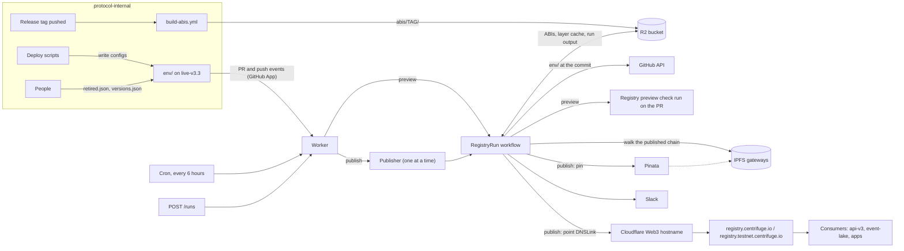

# How the registry works

The contract registry tells indexers and apps which Centrifuge protocol contracts exist on each chain:
every deployed contract with its address, deploy block and ABI, and, once a contract is out of use,
the block its listener ends at. There is one registry per network:

- **mainnet**, served at `https://registry.centrifuge.io`
- **testnet**, served at `https://registry.testnet.centrifuge.io`

Each registry is a chain of JSON documents on IPFS. A document is a **layer**, and it carries only
what changed since the layer before it, which it names by CID in `previousRegistry.ipfsHash`. The
first layer is a base snapshot. Reading the registry means walking the chain from the newest layer
back to the base and merging the layers, newest winning. Each hostname serves the newest layer of its
network: a Cloudflare Web3 gateway hostname whose DNSLink names that layer's CID.

This repository generates and publishes those layers. It runs as a Cloudflare Worker, triggered by
GitHub, and replaces the `script/registry/` scripts and `registry.yml` workflow that each live branch
of protocol-internal used to carry. The layer format is in [registry-format.md](registry-format.md),
day-to-day operation in [operations.md](operations.md).

## The pieces

| Piece                                     | What it does                                                                                                                                                            |
| ----------------------------------------- | ----------------------------------------------------------------------------------------------------------------------------------------------------------------------- |
| protocol-internal `env/`                  | The input. Deploy scripts write one config per chain on the release branch (`live-v3.3`); people write `retired.json`, `versions.json` and `registry.json` beside them. |
| Release tags (`v3.3.0`, …)                | Each contract's `version` resolves to a tag, and its ABI is built from that tag's source.                                                                               |
| `build-abis.yml` (protocol-internal)      | Builds a tag's ABIs once, when the tag is pushed, into the R2 bucket under `abis/<tag>/`. A Worker cannot run git or forge, so this is where ABIs come from.            |
| R2 bucket `centrifuge-protocol-registry`  | ABI bundles, a cache of published layers by CID, `env/` snapshots by commit, and every run's generated layers and report.                                               |
| GitHub App "Centrifuge Protocol Registry" | Installed on protocol-internal only. Sends the Worker push, pull request and check run events, and lets it read `env/` and post check runs.                             |
| The Worker                                | Receives the events, decides what each one asks for, and starts runs.                                                                                                   |
| Publisher (Durable Object)                | Lets one publish run at a time, so two publishes never race for the same hostname.                                                                                      |
| RegistryRun (Workflow)                    | One run, as durable steps that each retry on their own: read `env/`, check it, find the ABIs, generate and validate each network, then preview or publish.              |
| Pinata                                    | Pins each published layer to IPFS.                                                                                                                                      |
| Cloudflare Web3 hostnames                 | `registry.centrifuge.io` and `registry.testnet.centrifuge.io`, each pointed at a layer's CID.                                                                           |
| Slack                                     | Where publishes, refusals and failures are announced.                                                                                                                   |
| Consumers                                 | Indexers and apps that read the chain: api-v3, event-lake and the apps built on it.                                                                                     |

## The flow

## A change, from deploy to published layer

1. **A deploy writes configs.** A deploy script records what it deployed in
   `env/<environment>/<network>.json` on a branch, and someone opens a pull request into the release
   branch (`SOURCE_BRANCH` in `wrangler.jsonc`, `live-v3.3` today).
2. **The pull request gets a preview.** GitHub sends the App's `pull_request` event to
   `POST /webhooks/github`; the Worker checks its HMAC signature, lists the PR's files, and if any
   is under `env/` (other than the connections viewer) it posts a **Registry preview** check run and
   starts a preview run on the PR's head commit. A PR that touches nothing under `env/` gets no check,
   which is why the check cannot be a required one. "Re-run" on the check previews again.
3. **The run.** Its steps:
   1. **Resolve the commit:** the PR head for a preview, the release branch head for a publish.
   2. **Check `env/`** at that commit: the configs' schema, `retired.json`, `versions.json`, and that
      every contract `version` resolves to a tag. A problem here ends the run.
   3. **Ensure ABIs:** every tag `env/` uses must have a bundle in R2 built from the commit the tag
      points at. If one is missing, the step retries every 2 minutes for up to an hour, which covers a
      `build-abis.yml` run in flight, then fails naming the tag.
   4. **Generate each network:** walk its published chain from the live CID back to the base snapshot,
      compute the layer against the accumulated state, and validate it (see
      [registry-format.md](registry-format.md)).
   5. **Report:** a preview completes the check run with the layer each network would get and every
      finding; it fails when a layer would break the indexer. A publish goes on to step 6.
4. **The merge publishes.** The merge is a push to the release branch, and a push that touches `env/`
   asks the Publisher for a publish. The run generates from the branch head and then, for each network
   whose layer is publishable (it changes something) and has no errors:
   1. **pins** the layer to IPFS through Pinata, and
   2. **points** the network's hostname at the new CID, through the Cloudflare API, after checking the
      hostname still serves the CID the layer was built on. If anything else published in between, it
      stops rather than orphan that layer.

   Each network is judged on its own: an error on testnet does not hold back mainnet. Slack gets one
   message per publish naming what was published, pinned or refused.

5. **The cron reconciles.** Every six hours the Worker asks for a publish anyway, so a webhook GitHub
   dropped or a run that failed is retried without anyone noticing it first. A run with nothing to
   publish says nothing, and a cron run that would repeat the last message stays quiet.

A manual `POST /runs` (with the bearer token) can preview any commit or publish with options such as
a mode or a source CID; see [operations.md](operations.md).

## One publish at a time

Two publishes computed against the same tip would both pin a layer pointing at it, and the second
DNSLink swap would orphan the first. So every publish trigger (push, cron, manual) goes through the
Publisher, a single Durable Object: it starts a run when none is active, and otherwise keeps the
trigger as the one pending run, which starts when the active one ends. A run generates from the
branch head, so a newer trigger replaces the pending one, except that a manual run, which may carry
options, is not replaced by a push or the cron. An alarm polls whether the active run ended, so a run
that dies without reporting back cannot block publishing. Previews do not go through the Publisher:
they publish nothing.

## How far a publish goes: `PUBLISH_MODE`

| Mode     | Generates | Pins to IPFS | Points the hostname | Credentials it needs                 |
| -------- | :-------: | :----------: | :-----------------: | ------------------------------------ |
| `shadow` |     ✓     |              |                     | none beyond the App and Slack        |
| `pin`    |     ✓     |      ✓       |                     | `PINATA_JWT`                         |
| `live`   |     ✓     |      ✓       |          ✓          | `PINATA_JWT`, `CLOUDFLARE_API_TOKEN` |

`PUBLISH_MODE` is a variable in `wrangler.jsonc`, so changing it is a commit and a deploy. The Worker
only holds the credentials its mode needs (`scripts/push-secrets.sh` uploads by mode), and a mode
without its credentials refuses to run rather than doing less. Until `live`, the Worker cannot change
what the hostnames serve. In `pin`, a publishable layer is pinned and its CID posted to Slack, but
nothing points at it, which makes `pin` the place to inspect a real layer before it is served.

`CLOUDFLARE_API_TOKEN` is the token ops-v3 manages as "ops-v3 control web3 hostnames and DNS": Web3
Hostnames Write and DNS Read on `centrifuge.io`. It can repoint any Web3 hostname on the zone, not
only the registry's, which is why the Worker holds it only in `live`.

## What keeps a publish safe

- **Previews before merges.** Every PR that touches `env/` shows the exact layers it would publish,
  with every finding, before it merges.
- **Deltas against the whole chain.** A layer is computed against the accumulated state of every
  published layer, never against the newest one alone, so it carries exactly what changed.
- **Refusals instead of guesses.** A run stops when it cannot read the live layer, cannot walk the
  whole chain, meets a layer of the other network, or would produce a layer with validation errors.
  None of these publish anything.
- **Nothing is retired by omission.** A contract missing from `env/` stays as published; retirement is
  a declaration in `retired.json` (see [registry-format.md](registry-format.md#retirement)).
- **One publisher, and a moved tip stops it.** The Publisher serializes publishes, and a publish checks
  the hostname still serves the CID it built on before pointing it elsewhere.
- **Staged credentials.** `shadow`, `pin` and `live` hand the Worker one more capability each.

## Consumers

Consumers read the registry in one of two ways.

- **Following the hostname.** Fetch `https://registry.centrifuge.io`, then walk
  `previousRegistry.ipfsHash` back to the base snapshot and merge, older first, newer overriding.
  Whatever the hostname serves is what you get, so a new publish reaches you on your next read.
- **Pinning a head.** Keep the CID of the newest layer you have accepted, walk from it, and move it
  forward on purpose. event-lake works this way: it keeps one head per network in
  `registry.manifest.json`, checks every layer it reads against its CID, and builds the address book
  the indexer, handlers, private API and SDK use from it. The layer reading and verification it uses
  are published from this repository as `@centrifuge/registry-core` (see the README's Package
  section): `verifyLayer` proves the bytes are the ones a CID names, and `isAncestor` and
  `diffAddressHistories` check that a pin bump only moves forward and show what it changes.

api-v3 reads a `REGISTRY_URL`, which can be the hostname or a fixed layer. Its reader folds a
null-version patch layer into its predecessor and collapses consecutive layers with the same version.

Whichever way, a consumer ends a contract's listener at the `endBlock` its `retired` entry gives, and
never infers an end from the next release: pools migrate one by one, so a contract absent from a
newer layer is in use until it is retired.

## What lives where

| What                                                        | Where                                                                                                                                                                                                                                                        |
| ----------------------------------------------------------- | ------------------------------------------------------------------------------------------------------------------------------------------------------------------------------------------------------------------------------------------------------------ |
| Configs, `retired.json`, `versions.json`, `registry.json`   | protocol-internal, `env/` on the release branch                                                                                                                                                                                                              |
| ABI builds                                                  | protocol-internal `main`, `.github/workflows/build-abis.yml`, with the repository secrets `R2_ACCESS_KEY_ID` / `R2_SECRET_ACCESS_KEY`                                                                                                                        |
| R2 bucket `centrifuge-protocol-registry` (Official account) | `abis/<tag>/` (ABI bundles), `layers/<cid>.json` (published layers, cached), `snapshots/<sha>.json` (`env/` at a commit), `runs/<id>/` (each run's layers, validation and report). The bucket and the R2 token are in ops-v3; see the README's Setup section |
| The Worker                                                  | This repository. Settings in `wrangler.jsonc` (`SOURCE_REPO`, `SOURCE_BRANCH`, `PUBLISH_MODE`, hostnames, zone); deployed with `scripts/deploy.sh`, which labels each version with its commit                                                                |
| Worker secrets                                              | The 1Password Environment "protocol-registry Worker": `GITHUB_APP_ID`, `GITHUB_APP_PRIVATE_KEY`, `GITHUB_WEBHOOK_SECRET`, `SLACK_WEBHOOK_URL`, `MANUAL_TRIGGER_TOKEN`, `PINATA_JWT`. Uploaded with `scripts/push-secrets.sh`                                 |
| `CLOUDFLARE_API_TOKEN`                                      | ops-v3 `tokens.yaml`, "ops-v3 control web3 hostnames and DNS", whose 1Password item `.env.1password` references; its reconciler rotates it                                                                                                                   |
| The GitHub App                                              | GitHub organization settings; installed on protocol-internal only                                                                                                                                                                                            |
| Hostnames                                                   | Cloudflare, Web3 gateways on the `centrifuge.io` zone                                                                                                                                                                                                        |
| `@centrifuge/registry-core`                                 | npmjs, published from this repository's `publish-registry-core.yml` on a GitHub release, in the `release` environment                                                                                                                                        |
| Repository rules                                            | `main`: changes by pull request with one approval, signed commits, squash merges, the `checks` CI job. `registry-core-v*` tags: only admins create, move or delete them                                                                                      |

## Cutting a release

A new release branch (`live-v3.4`) is a change to `SOURCE_BRANCH` in `wrangler.jsonc` and a deploy.
Its tags are built by `build-abis.yml` when they are pushed. A tag pushed with `GITHUB_TOKEN`, or in a
push of more than three tags, starts no run on GitHub, and a run that needs it fails naming the tag;
dispatch the workflow for it by hand (see [operations.md](operations.md#abis)).
